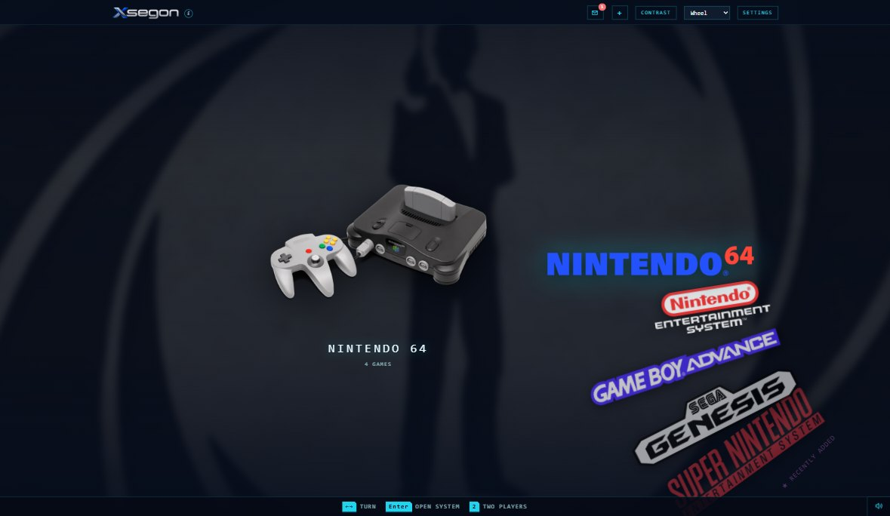
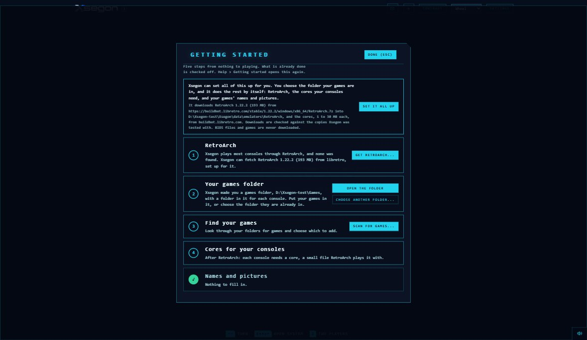
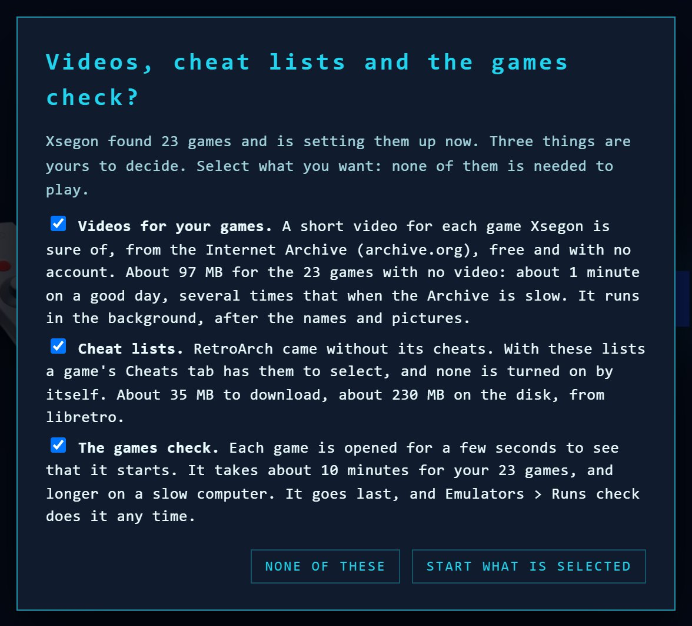
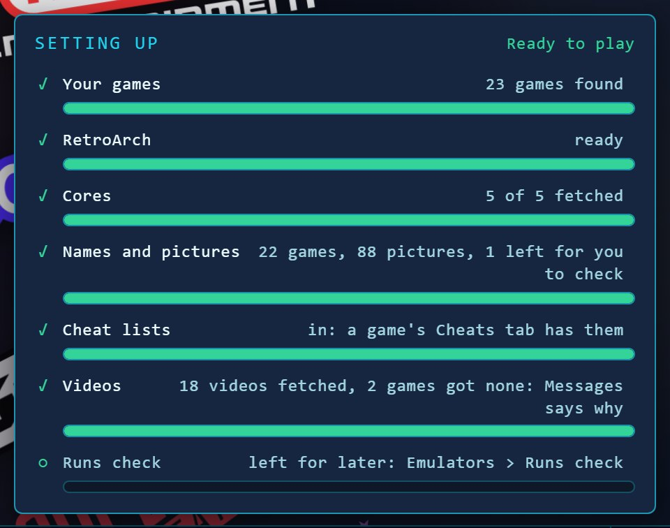
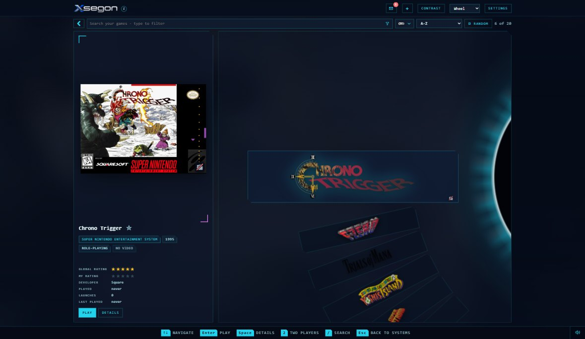
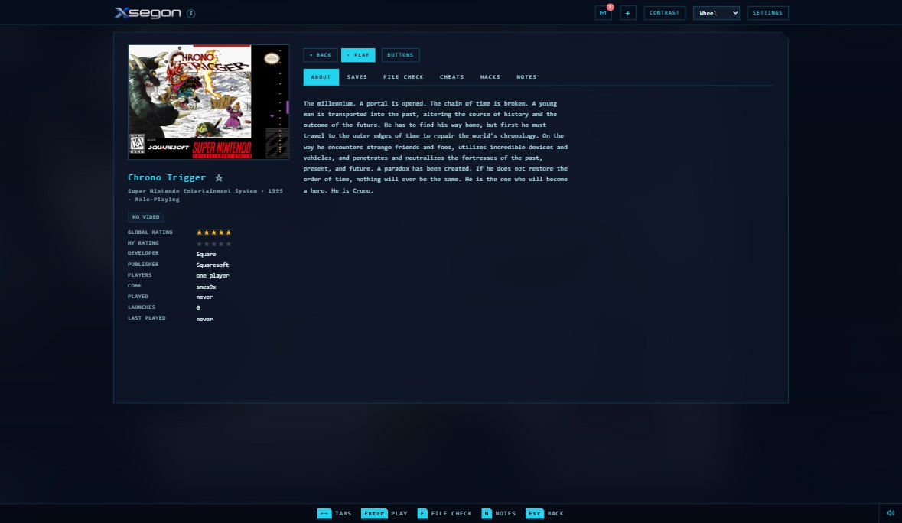
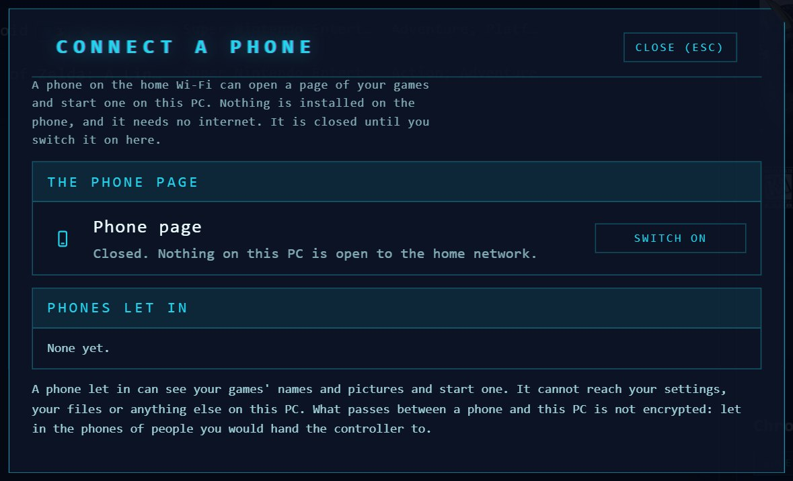
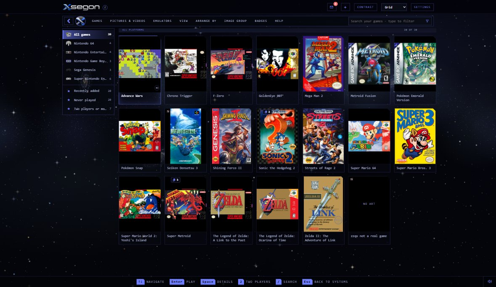
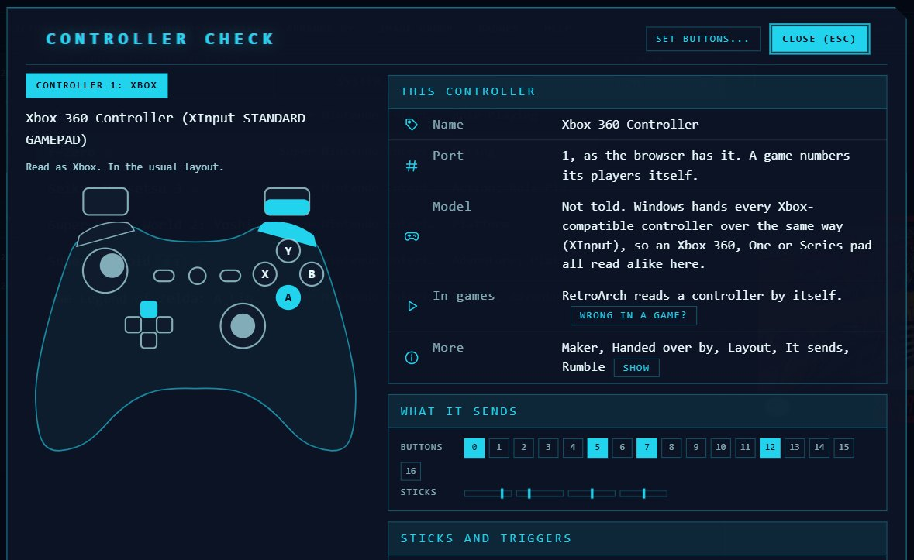

# Xsegon

Xsegon shows your games like a console menu and starts them for you. It is
made for a TV and a controller, and it is just as happy with a keyboard and
mouse. It runs on your own Windows PC, needs no account, and is free.

> **Download Xsegon from the [Releases page](https://github.com/TumultuousProductions/Xsegon/releases/latest),
> not with the green Code button on this page.** The release zip has
> everything inside: Xsegon, the PHP it runs on, RetroArch and the games
> database. The code here on its own is for people who work on Xsegon, and
> does not run without the parts the zip adds.

Xsegon does not come with any games, BIOS files or keys. You bring your own.

## 1. What you need

- A PC with Windows 10 or 11. Xsegon opens in Chrome or Edge, and Edge is
  already on Windows.
- Your own game files.
- About 2 GB of free space, and the internet for the first few minutes (the
  cores your consoles need, and your games' names and pictures).
- A controller, if you have one. It works as soon as you press a button on it.

## 2. Start it

1. Open the [latest release](https://github.com/TumultuousProductions/Xsegon/releases/latest)
   and, under **Assets**, download **Xsegon-*version*.zip**.
2. Right-click the zip, choose **Properties**, select **Unblock** at the
   bottom if it is there, and press OK. Then right-click it again, choose
   **Extract All...**, and put it somewhere simple, like Documents. Not in
   Program Files, which Windows does not let programs save into.
3. Open the folder it made and double-click **Start Xsegon.bat**.
4. If Windows says "Windows protected your PC", press **More info**, then
   **Run anyway**. It says that because Xsegon is home-made and not signed,
   not because anything is wrong.

Xsegon opens full screen. To close it, use the X at its top right (it asks
first), or press Alt+F4. The folder also has **Welcome to Xsegon.html**: the
same tour as below, with more pictures, to open in your browser.

## 3. Let it set itself up

The first time, Xsegon opens on **Getting started**. Three presses and you
are playing:

1. Press **Set it all up**.
2. Choose the folder your games are in. Any folder works: Xsegon looks inside
   every folder under it.
3. Select the extras you want (videos for your games, the cheat lists, and a
   check that opens each game for a moment to see that it starts), or press
   **None of these**. Each one can be had later from the menus.

Then leave it to it. A small list in the corner shows what it is doing:
setting up RetroArch (the program that plays the games, which comes with
Xsegon), fetching the cores your consoles need, finding your games, and
fetching their names and box art. When the list says **Ready to play**, you
are. You can look around while it works.

Not sure where to put your games? Xsegon made a **Games** folder beside
itself, with a folder inside for each console. Getting started says where it
is, and **Open the folder** opens it. Drop your games in, then press **Set it
all up**.

## 4. Getting around

You start on your consoles. Turn to one and open it to see its games.

| To | Keyboard | Controller |
|---|---|---|
| Move | The arrow keys | The cross or the left stick |
| Open a console, or play a game | Enter | A |
| Go back | Esc | B |
| See a game's own page | Space | X |
| A game's menu | Right-click | Y |
| Find a game | / and a few letters | |
| Change how the games are shown | G | |
| Stop playing a game | Esc, in the game | |

You do not have to remember any of it: the bar along the bottom of the
screen always shows what the keys do right now, and with a controller it
shows that controller's own buttons.

## 5. What else it does

- **Six ways to look at your games**, from the wheel to a list with the
  columns you choose.
- **Names, descriptions and box art filled in** from a copy of the LaunchBox
  Games Database that comes with Xsegon. If its picture server ever stops
  answering, libretro's thumbnails fill in instead.
- **Your games on your phone.** Look through them on the phone, tap one, and
  it starts on the PC. Same Wi-Fi, nothing installed on the phone.
- **Videos for your games**, from free online archives, arcade games included.
- **Themes**, some that move: a sky of stars, the deep sea, a storm.
- **Saves, cheats and versions.** Pick up where you left off, turn a cheat on
  in one press, and choose which version of a game plays.
- **Any controller.** The bar names your controller's own buttons, and the
  Controller check lights up what you press.
- **Steam games and programs of your own** in the same library.
- **Coming from LaunchBox?** Games > Bring in a LaunchBox library... brings
  your games and your own play data across, once. Nothing of LaunchBox's
  pictures, videos or sounds comes with them, and LaunchBox's folder is
  never changed.

## 6. If something goes wrong

- **Stuck somewhere?** Press Esc a few times. It always backs out one step.
- **Still stuck?** Close Xsegon and start it again. Nothing is lost: it keeps
  everything as you go.
- **Games with names but no pictures?** Choose List or Grid, then Pictures &
  Videos > Get Pictures.
- **A game will not start?** A red line at the bottom says why. A few consoles
  (the PlayStation is one) need a BIOS file of your own: Emulators > BIOS
  check says which one and where it goes. Xsegon never downloads one.
- **A controller that works in Xsegon and not in a game?** The Controller
  check has Wrong in a game?, which says what to do.
- **Xsegon will not open at all?** A black window comes up and says why.

## Updating to a newer version

1. Settings > Library > Backup, to be safe.
2. Close Xsegon.
3. Download the new zip from the [latest release](https://github.com/TumultuousProductions/Xsegon/releases/latest)
   and unblock it as in step 2 above.
4. Extract it into the **same folder** as before, and choose **Replace the
   files** when Windows asks.

Your games, settings, play history and pictures live in the `Xsegon\data`
folder. The download has no `data` folder, so extracting over the old one
keeps them.

## Good to know

- Your game files are only ever read. Xsegon never changes or moves them.
- Everything Xsegon makes lives inside the folder you unzipped. To remove it,
  close Xsegon and delete that folder. Nothing is installed anywhere else.
- After the first setup it works without the internet. Only fetching
  pictures, videos and cheat lists needs it.
- It only ever answers this PC: nothing else on your network can reach it,
  unless you switch on Connect a phone.

## Help

Settings > Debug > Report a problem... > Make a report > Save a copy puts what
happened into one small file in your Downloads folder. Send it, with a line
or two about what you were doing, to help@tumultuousproductions.site. It holds
Xsegon's own record of what happened, your settings and the names of your
games; never your games, pictures or videos.

## A very large library

Xsegon lets each of its requests use up to 1.5 GB of memory, where PHP by
itself allows 128 MB. A request takes only what it needs: about 30 MB for
750 games, about 300 MB for 40,000. The 1.5 GB is room for a library of
about 200,000 games.

A list longer than 2,000 games opens on its first 2,000 at once, and the
rest is added as you go, a piece at a time between your presses, with a bar
in the corner until every game is in. Settings > View > Games shown at once
is how many open at once. In Random order a list shows that many and no
more, and says so. With tens of thousands of games in a single list, moving
through it is slower than in a small one.

For more than that, raise `memory_limit` in the `php.ini` of the PHP that
runs Xsegon (in a download, `Xsegon\runtime\php\php.ini`) to a larger
figure such as `4G`, and start Xsegon again. A setting higher than
Xsegon's own is left as it is.

## Running from the source code

This part is for people who work on Xsegon. To play, use the
[release download](https://github.com/TumultuousProductions/Xsegon/releases/latest).

- **PHP 8** (tested on 8.5), with the `curl`, `mbstring` and `openssl`
  extensions switched on in `php.ini`, either on your PATH or unzipped beside
  the Xsegon folder. The games database is read by the same PHP, with its
  `sqlite3`, `bz2` and `intl` extensions, which Xsegon loads itself.
- **Node.js 22.5 or newer**, only for the tests and the tools in `tools\`.
  Xsegon itself does not use it.

Then run `.\start.ps1` in PowerShell. Some parts are not in the repository
and are fetched by a tool, each pinned to one checked version:

| Part | Fetched by |
|---|---|
| The games database (about 70 MB) | Xsegon itself, the first time it starts ([gamesdb/README.md](gamesdb/README.md)) |
| 7-Zip's `7zr.exe` | `node tools\get-7zr.js` |
| `ffmpeg.exe` | `node tools\get-ffmpeg.js` |
| RetroArch's archive | `node tools\get-retroarch.js` |
| Ovani Sound's five interface sounds | `node tools\get-ovani-sounds.js <the pack you bought>` |

Without Ovani's sounds, a copy run from the source plays the Xsegon 2 set in
their place.

- `node tests\run.js` runs the tests (`node tests\lanes.js` runs them in two
  lanes, `node tests\lanes.js quick` in about three minutes).
- `node tools\make-test-copy.js <folder> --release` makes the download.
- `node tools\privacy-scan.js` checks what the repository would hold for
  anything that belongs to the PC it was written on; `tools\hooks\pre-push`
  runs it before every push (`git config core.hooksPath tools/hooks`).

## License

MIT (see [LICENSE](LICENSE)). The games database Xsegon downloads is
LaunchBox's, not covered by it; see Credits. Nor are the five Ovani Sound
sounds in [sounds/Xsegon](sounds/Xsegon/ABOUT.txt), the set Xsegon starts
on, which come with the download, not with this repository (its Hover.wav
is Xsegon's own, under MIT), nor the programs the download carries
unchanged, each under its own licence with that licence beside it: 7-Zip's
`7zr.exe` (GNU LGPL), `ffmpeg.exe` (GNU GPL v3) and RetroArch (GNU GPL v3),
nor the console icons in [img/consoles](img/consoles/ABOUT.txt), which are
RetroArch's (CC-BY 4.0), nor the console name logos in
[img/console-logos](img/console-logos/ABOUT.txt), which are their owners'
trademarks (see Trademarks). [THIRD-PARTY.txt](THIRD-PARTY.txt) lists every
part that is not Xsegon's own. The sounds in
[sounds/Xsegon 2](sounds/Xsegon%202/ABOUT.txt) are Xsegon's own.

## Trademarks

The names and logos of the consoles Xsegon lists are trademarks of their
owners: Nintendo, Sony Interactive Entertainment, Microsoft, Sega, Atari,
SNK and the others whose consoles it names. MAME is a registered trademark
of Gregory Ember; its logo stands on Arcade and MAME. Xsegon shows them for
one purpose, to say which console a game is for. It is not made, sponsored,
approved or endorsed by any of those companies or by the MAME team, and has
no connection with them. Xsegon comes with no games, no BIOS files and no keys. An owner who
wants a logo taken out has only to ask: help@tumultuousproductions.site.

## Credits

- Game details, descriptions and pictures: the
  [LaunchBox Games Database](https://gamesdb.launchbox-app.com), by
  [LaunchBox](https://www.launchbox-app.com) and the people who add to it. A
  copy comes with the download and keeps itself up to date
  ([gamesdb/](gamesdb/README.md)).
- Names, details and pictures when that is not used, or its pictures cannot
  be fetched: [libretro](https://github.com/libretro) (libretro-thumbnails and
  libretro-database), the lists RetroArch uses.
- Games are started by [RetroArch](https://www.retroarch.com), by libretro,
  carried unchanged in the download under the GNU GPL v3, with its licence
  and where its source is beside it (`runtime\RetroArch`).
- The console icons: RetroArch's menu icons (the XMB "retrosystem" theme, and
  "daite" for the PSP) by the libretro team and contributors, from
  [retroarch-assets](https://github.com/libretro/retroarch-assets), unchanged,
  under [CC-BY 4.0](https://creativecommons.org/licenses/by/4.0/)
  ([img/consoles/ABOUT.txt](img/consoles/ABOUT.txt); `node
  tools\get-console-icons.js` fetches them).
- The console name logos on the wheel, and Steam's icon: 53 files from
  [Wikimedia Commons](https://commons.wikimedia.org/wiki/Category:Video_game_console_logos),
  each marked Public domain or CC0 on its page there and each still its
  owner's trademark. Dark ones are lightened for a dark screen; nothing is
  redrawn. [img/console-logos/ABOUT.txt](img/console-logos/ABOUT.txt) lists
  every one with its owner, its page and who Commons names as its author
  (`php tools\get-console-logos.php` fetches them and checks each mark).
- The built-in sound set Xsegon starts on: "Fantasy UI Sound FX Pack Vol. 1"
  by [Ovani Sound](https://ovanisound.com), under their royalty-free licence
  ([sounds/Xsegon/ABOUT.txt](sounds/Xsegon/ABOUT.txt)). Its five sounds are
  in the download and not in this repository, since they may not be handed
  out on their own.
- Unpacking RetroArch: `7zr.exe` from [7-Zip](https://www.7-zip.org) by Igor
  Pavlov, shipped unchanged in the download under the GNU LGPL (`node
  tools\get-7zr.js` fetches it into a checkout).
- The controller outlines in Settings > Xsegon Controls: the Xbox 360 gamepad
  by Grumbel of the Open Clip Art Library
  ([Wikimedia Commons](https://commons.wikimedia.org/wiki/File:Xbox360_gamepad.svg),
  CC0) and the DualShock 4 layout by Tokyoship
  ([Wikimedia Commons](https://commons.wikimedia.org/wiki/File:Dualshock_4_Layout.svg),
  [CC BY 3.0](https://creativecommons.org/licenses/by/3.0/)). Only the outline
  of each is used, scaled, with no logo or lettering (`js\padpic.js`). The
  shapes of the controllers are their makers' own.
- The names of arcade games: MAME's own list of its machines, from
  [MAME](https://www.mamedev.org) by the MAME team (GNU GPL version 2 or
  later, most of its source BSD 3-Clause). Xsegon keeps four facts a
  machine, its short name, title, kind and parent
  ([includes/arcade/ABOUT.txt](includes/arcade/ABOUT.txt);
  `php tools\get-arcade-names.php` makes it). Xsegon comes with no MAME and
  no arcade games.
- Videos of arcade games, where a person asks for them (Pictures & Videos >
  Videos from online archives, which asks here first): scraping using
  [Arcade Database](https://adb.arcadeitalia.net) by motoschifo. The videos
  are its Progetto VideoSnaps, played and recorded by motoschifo, AntoPISA,
  adolfo69 and others, each named inside its file. Xsegon carries none of
  them: it asks about one game at a time and fetches the video for the game
  on the person's own PC.
- Videos for the other games with none, where a person asks (Pictures &
  Videos > Videos from online archives): sets of game videos on the
  [Internet Archive](https://archive.org), and the recordings of
  [World of Longplays](https://longplays.org), whole games played by its
  members and put on the Archive, each recording naming its player. Where a
  set leaves a gap, Xsegon keeps the first 30 seconds of the game's recording
  as its video and writes the player's name in its log. Xsegon carries none
  of the videos ([includes/archivevid/ABOUT.txt](includes/archivevid/ABOUT.txt)).
- Cutting those recordings: `ffmpeg.exe` from the
  [FFmpeg project](https://ffmpeg.org), the release essentials build for
  Windows by [Gyan Doshi](https://www.gyan.dev/ffmpeg/builds/), shipped
  unchanged in the download under the GNU GPL v3 with its licence beside it
  (`node tools\get-ffmpeg.js` fetches it into a checkout).
- The list of controllers read for a controller the browser does not know:
  [SDL_GameControllerDB](https://github.com/mdqinc/SDL_GameControllerDB), under
  the zlib licence, unchanged, with its licence beside it in
  `includes\padlist\` (`node tools\get-controller-list.js` fetches it).
- The colours of the Dracula themes: the [Dracula](https://draculatheme.com)
  colour palette, Copyright (c) 2023 Dracula Theme, under the
  [MIT licence](https://github.com/dracula/dracula-theme/blob/main/LICENSE).
  The quilt behind them and the bat are Xsegon's own drawing.
