<p align="center">
  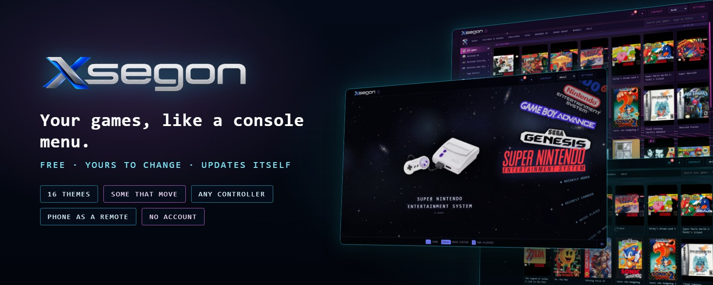
</p>

<p align="center">
  <a href="https://github.com/TumultuousProductions/Xsegon/releases/latest"></a>
  <a href="https://github.com/TumultuousProductions/Xsegon/releases"></a>
  
  
  
  <a href="LICENSE"></a>
</p>

<h3 align="center">Xsegon shows your games like a console menu and starts them for you.</h3>

<p align="center">
  Made for a TV and a controller, and just as happy with a keyboard and mouse.<br>
  It runs on your own Windows PC, needs no account, and is free. All of it.
</p>

<p align="center">
  <a href="https://github.com/TumultuousProductions/Xsegon/releases/latest"><b>Download Xsegon</b></a>
  &nbsp;·&nbsp; <a href="#themes-that-move">Themes</a>
  &nbsp;·&nbsp; <a href="#yours-to-change">Yours to change</a>
  &nbsp;·&nbsp; <a href="#it-updates-itself-when-you-say">Updates</a>
  &nbsp;·&nbsp; <a href="#how-xsegon-compares">How it compares</a>
  &nbsp;·&nbsp; <a href="#2-install">Install</a>
</p>

<p align="center">
  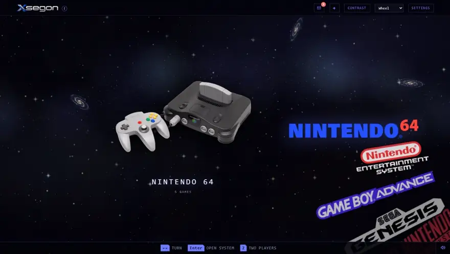
  <br><sub><i>Turn to a console, open it, rest on a game. Space opens its own page.</i></sub>
</p>

> **Download Xsegon from the [Releases page](https://github.com/TumultuousProductions/Xsegon/releases/latest),
> not with the green Code button on this page.** The release zip has
> everything inside: Xsegon, the PHP it runs on, RetroArch and the games
> database. The code here on its own is for people who work on Xsegon, and
> does not run without the parts the zip adds.

Xsegon does not come with any games, BIOS files or keys. You bring your own.

## Why Xsegon

<table>
<tr>
<td width="33%" valign="top">

**Free, all of it**<br>
No account, no paid tier, no big-screen mode held back. The TV view, the
themes, the phone remote and every update are in the one free download.

</td>
<td width="33%" valign="top">

**Everything in one download**<br>
RetroArch, the PHP it runs on and a copy of the LaunchBox Games Database come
inside the zip. One window sets it all up, then it says **Ready to play**.

</td>
<td width="33%" valign="top">

**It checks your games start**<br>
Xsegon can open each game for a moment to see that it starts, and marks the
ones that do not, with why. You find out before you sit down to play.

</td>
</tr>
<tr>
<td valign="top">

**Themes that move**<br>
Sixteen themes, and most of them move: stars drifting over galaxies, the deep
sea, a storm, snow, digital rain, a synthwave floor, embers, and a bat now and then.

</td>
<td valign="top">

**Yours to change**<br>
Every screen is a plain file. Change one in Notepad, save, press F5. Nothing to
build, nothing to install, and your own look is kept through every update.

</td>
<td valign="top">

**It updates itself, when you say**<br>
Told once per version. Update now checks the new version against a signed
list, tries it, backs up your data, and puts the old one back if it fails.

</td>
</tr>
<tr>
<td valign="top">

**Your phone as a remote**<br>
Scan a square on the TV with your phone, look through your games, tap one,
and it starts on the PC. Same Wi-Fi, nothing installed on the phone.

</td>
<td valign="top">

**Any controller**<br>
Press a button and it works. The bar along the bottom names your own
controller's buttons, Xbox, PlayStation or Nintendo, and thousands more are known.

</td>
<td valign="top">

**Videos, cheats and texture packs**<br>
Videos from free online archives, cheats in one press, and the texture packs
made for your PS2, GameCube, Wii and N64 games, put in place for you.

</td>
</tr>
</table>

## Themes that move

Press the Xsegon logo at the top left, and under **Themes** there are
sixteen, most of them in five folders. Most of them move, gently, behind your
games.

<table>
<tr>
<td width="33%" align="center">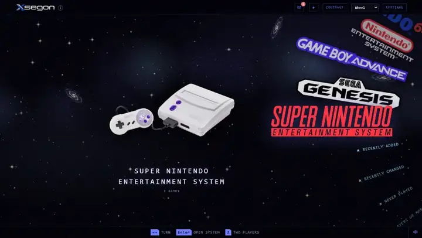<br><b>Space</b><br><sub>Stars drift over galaxies, and one falls now and then.</sub></td>
<td width="33%" align="center">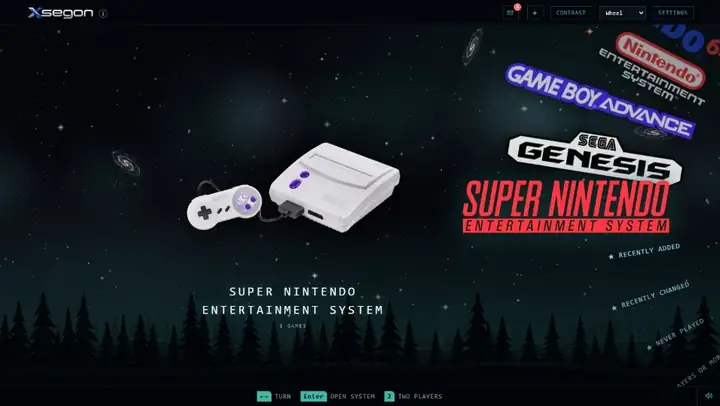<br><b>Space with trees</b><br><sub>The same sky, over a wood of firs.</sub></td>
<td width="33%" align="center">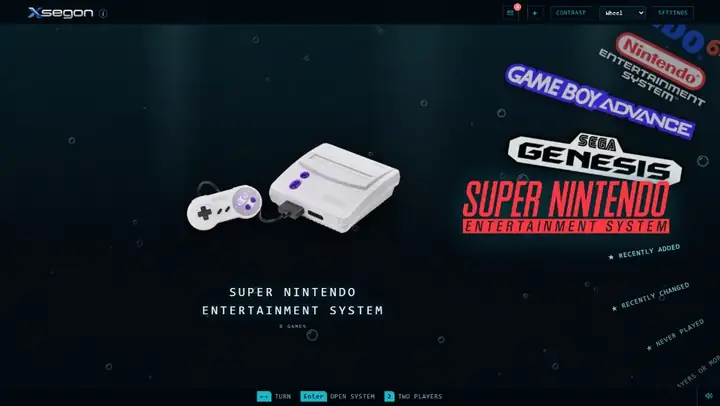<br><b>Deep sea</b><br><sub>Bubbles rise from the dark.</sub></td>
</tr>
<tr>
<td align="center">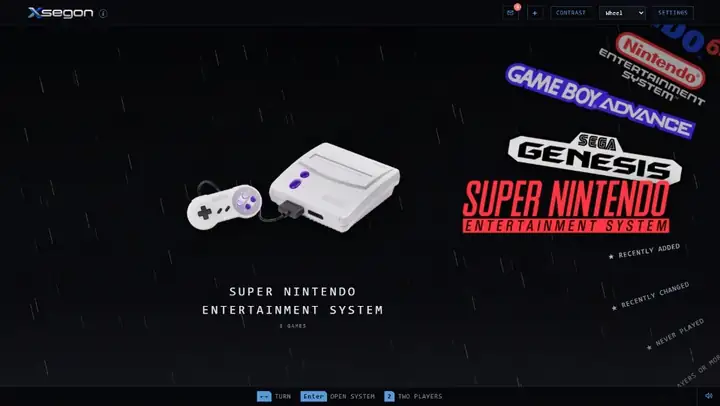<br><b>Storm</b><br><sub>Rain falls at a slant.</sub></td>
<td align="center">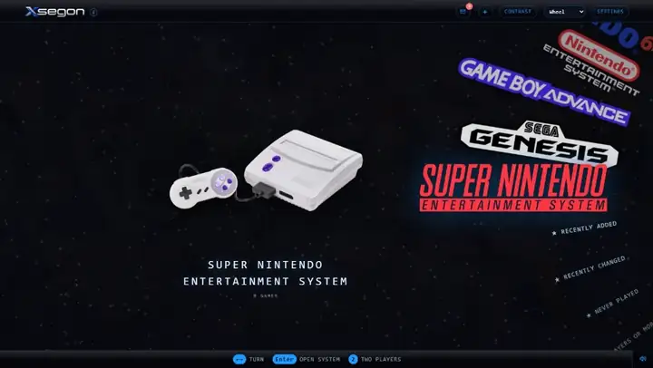<br><b>Winter</b><br><sub>Snow falls behind panes of glass.</sub></td>
<td align="center">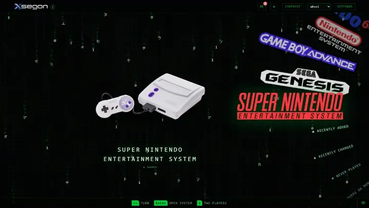<br><b>Matrix</b><br><sub>Digital rain behind see-through panels.</sub></td>
</tr>
<tr>
<td align="center">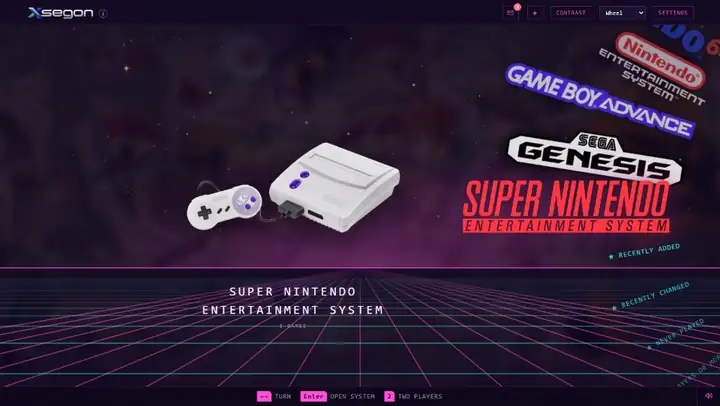<br><b>Synthwave</b><br><sub>A floor of lines rolls to a glowing horizon.</sub></td>
<td align="center">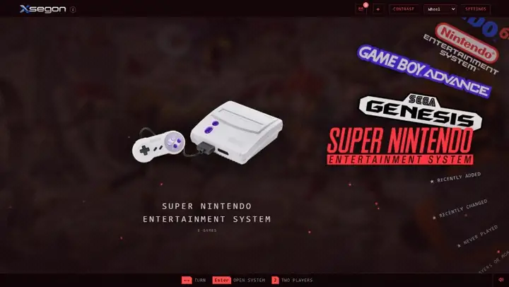<br><b>Carbon</b><br><sub>Five dark reds on a carbon weave, with embers.</sub></td>
<td align="center">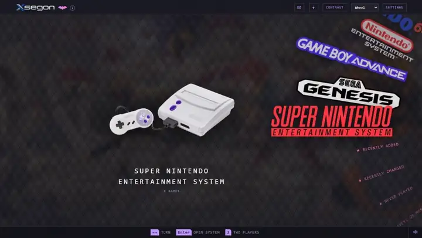<br><b>Dracula</b><br><sub>Quilted leather, and a bat crosses now and then.</sub></td>
</tr>
</table>

And three more of the sixteen:

<p align="center">
  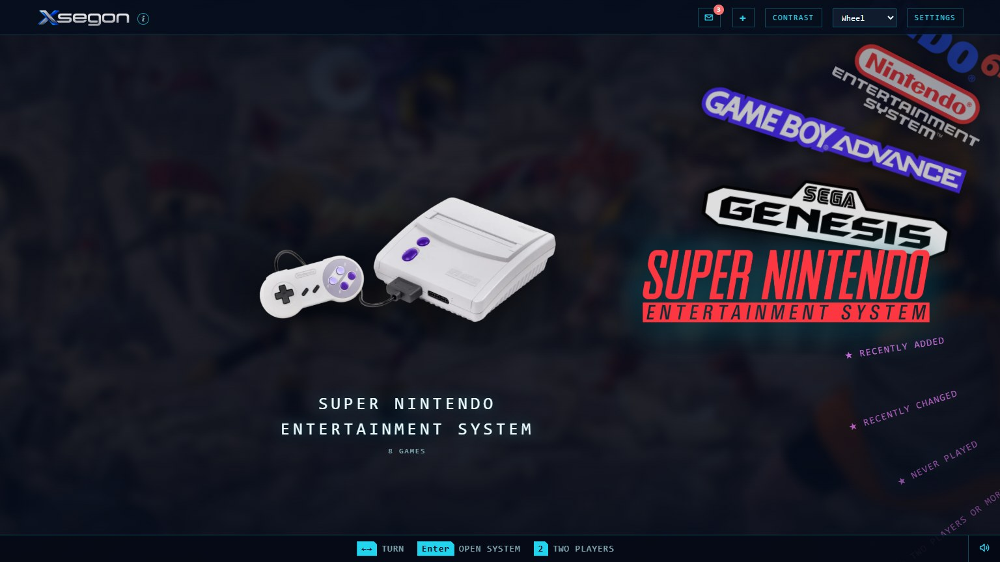
  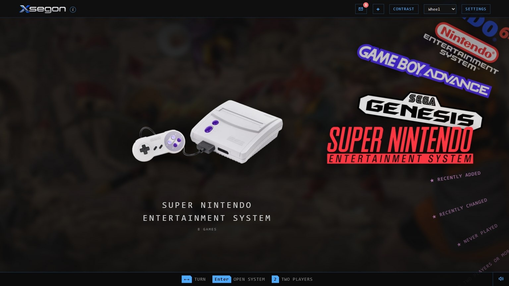
  
</p>
<p align="center"><sub><i>Xsegon, the one it comes in. Dark. Dark red strong weave.</i></sub></p>

**Make your own theme.** A theme is one small file. Copy one in the `themes`
folder, such as `themes\neon\synthwave.json`, give it a new name and change
its colours, and it shows under Themes. A theme you add is kept through
updates.

```json
{
  "format": 1,
  "name": "My theme",
  "colours": {
    "ground": "#120a22",
    "panel": "#1b1132",
    "panelRaised": "#281a47",
    "words": "#f4eeff",
    "wordsSecond": "#bcabdd",
    "wordsThird": "#9a88bf",
    "highlight": "#ff4fd8",
    "highlightSecond": "#36f9f6"
  },
  "has": { "glow": true, "scanlines": false },
  "texture": { "kind": "horizon", "strength": 100 }
}
```

The accent colour, the size of the menu words, glow, scanlines and High
contrast are in Settings > Feel too.

## Yours to change

<p align="center">
  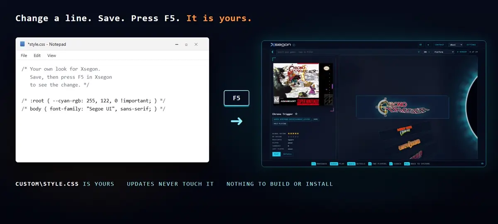
</p>

Xsegon is yours to change, with nothing to learn first:

- **Its look.** Themes, some of them moving, and your own:
  Settings > Feel > Your own look > Open my folder gives you a stylesheet
  that Xsegon reads after its own. Change a colour or a size, save, and press
  F5.
- **Its sounds and pictures.** Your own sound for each press, and your own
  picture for any console.
- **Its code.** Every screen is a plain file you can open in Notepad: change
  it, save it, refresh. Nothing to build and nothing to install.
  [Change Xsegon yourself](CONTRIBUTING.md) says which file draws what.
- **Kept through every update.** Update now never touches your games,
  settings, pictures or your own folder, and a file of Xsegon's you changed
  is kept aside and named, never lost.

## It updates itself, when you say

<p align="center">
  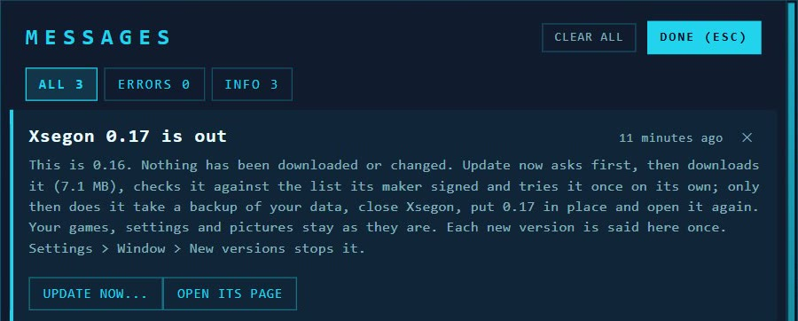
  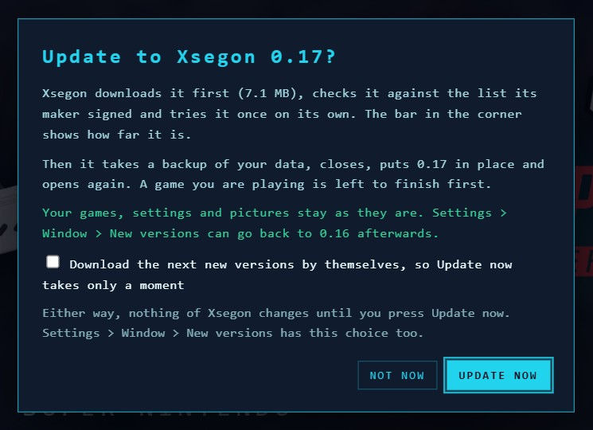
</p>
<p align="center"><sub><i>A new version is said once, in Messages. Update now says what happens and asks first.</i></sub></p>

- **Said once, never pushed.** Xsegon looks once a day and says in Messages
  when a new version is out, once for each version. Nothing is downloaded or
  changed until you press **Update now**.
- **Your choice of how.** The Update now window asks whether the next
  versions should download by themselves, so Update now takes only a moment.
  Leave it off and each one downloads when you press (about 7 MB).
- **Checked before it is trusted.** Each new version is checked against a
  list its maker signed, and tried once on its own, before your copy is
  touched. A damaged or changed download is never put in place.
- **Safe to say yes.** It takes a backup of your data, closes, puts the new
  version in place and opens again by itself. If the new version will not
  start on your PC, the one before comes back by itself, and Settings >
  Window > New versions has **Go back** any time.
- **Never in the way.** A game you are playing is left to finish first.

<p align="center">
  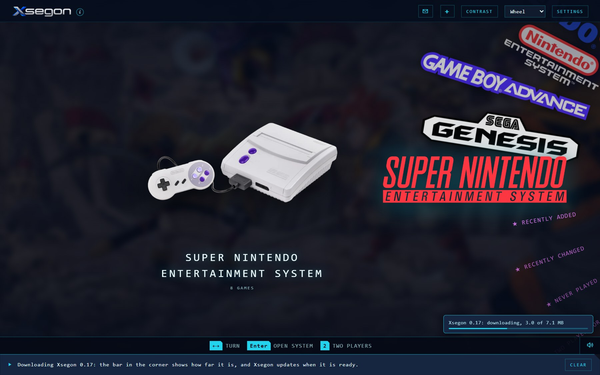
</p>

## Six ways to see your games

Press **G** to change how the games are shown, or pick one at the top right.

<table>
<tr>
<td width="33%" align="center">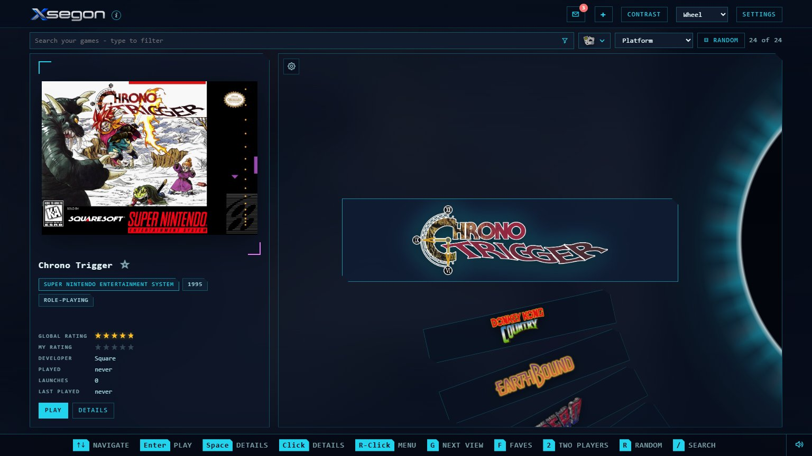<br><b>Wheel</b></td>
<td width="33%" align="center">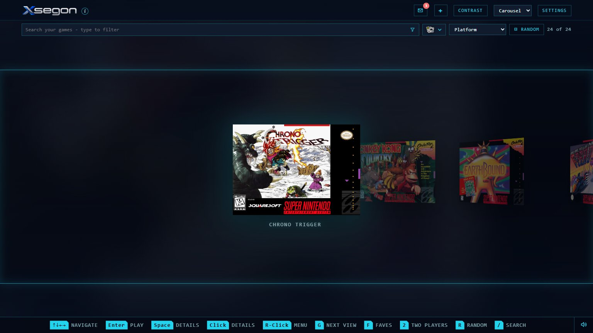<br><b>Carousel</b></td>
<td width="33%" align="center">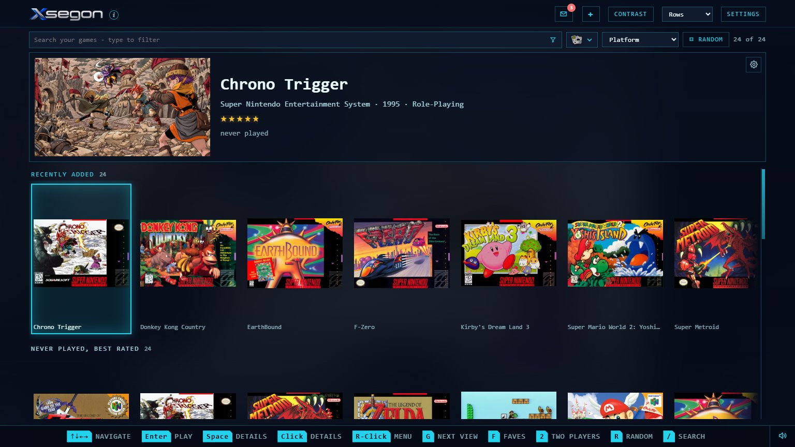<br><b>Rows</b></td>
</tr>
<tr>
<td align="center">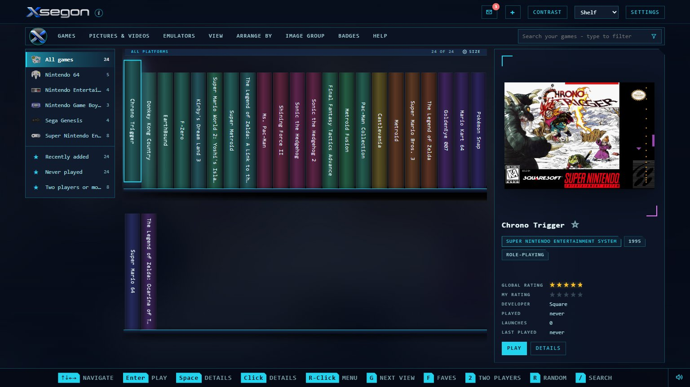<br><b>Shelf</b></td>
<td align="center">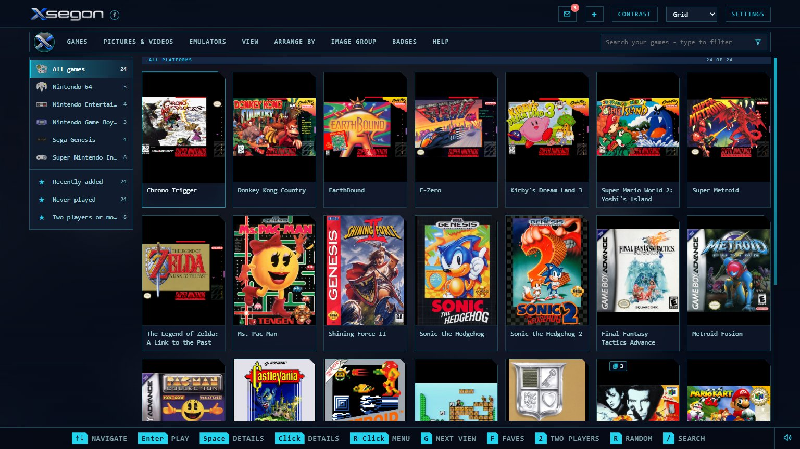<br><b>Grid</b></td>
<td align="center">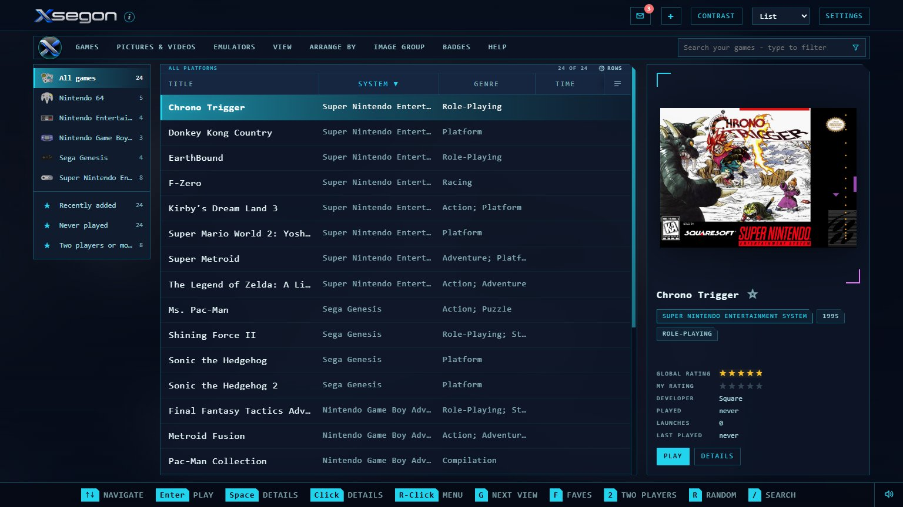<br><b>List</b></td>
</tr>
</table>

## Every game has its own page

<p align="center">
  
</p>

<p align="center">
  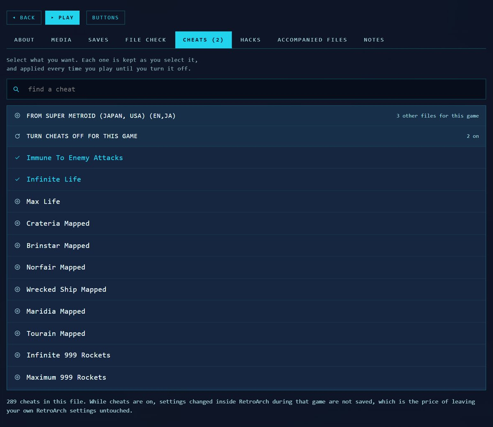
  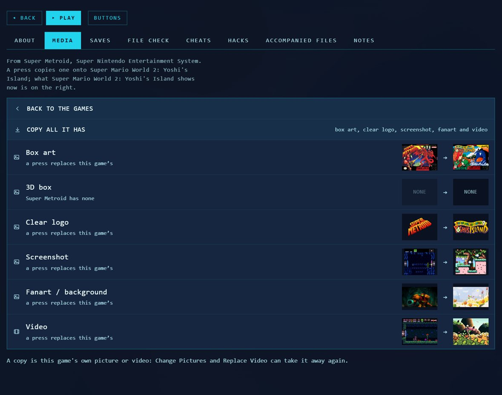
</p>
<p align="center"><sub><i>Cheats in one press, and a game's Media tab copying another game's pictures.</i></sub></p>

Its story, its saves, its cheats, its versions, its texture packs and your own
notes, each in a tab. A game's video plays as you rest on it.

<p align="center">
  
  
</p>
<p align="center"><sub><i>Connect a phone, and the Controller check, which lights up what you press.</i></sub></p>

## And all this, free

- **New games come in by themselves.** Put games in your games folder, come
  back to Xsegon, and they are there.
- **Names, descriptions and box art filled in** from a copy of the LaunchBox
  Games Database that comes with Xsegon. If its picture server ever stops
  answering, libretro's thumbnails fill in instead.
- **Videos for your games** from free online archives, arcade games
  included, and from ScreenScraper with only a free member account.
- **Saves, cheats and versions.** Pick up where you left off, turn a cheat on
  in one press, and choose which version of a game plays.
- **Texture packs** for PS2, GameCube, Wii and N64 games: the packs made for
  each game listed in its page, and put in place with one press.
- **Pictures and videos your way.** Change any of them, clear them, or copy
  another game's onto it.
- **What each file really is**, read from its checksum: region, revision,
  translation or hack.
- **Steam games and programs of your own** in the same library.
- **Backups** of everything Xsegon keeps, part by part, read back before they
  are called made.
- **Big libraries.** A list of 40,000 games opens on its first 2,000 at once
  and the rest comes in as you go.
- **Your files left alone.** Your game files are only ever read. Xsegon never
  changes or moves them, and after the first setup it works without the
  internet.
- **Coming from LaunchBox?** Games > Bring in a LaunchBox library... brings
  your games and your own play data across, once. Nothing of LaunchBox's
  pictures, videos or sounds comes with them, and LaunchBox's folder is
  never changed.

## How Xsegon compares

Each of these is a good program, and people love them. This is where Xsegon
is different.

| | **Xsegon** | LaunchBox and Big Box | Playnite | ES-DE | RetroBat |
|---|---|---|---|---|---|
| **The TV and controller view** | ✅ Free | Big Box is Premium: $30, or $75 for life (free 30 minute trial sessions) | Free | Free | Free |
| **Open source** | ✅ MIT | No | MIT | MIT (desktop) | LGPL v3 and CC BY-NC-SA |
| **Account needed** | ✅ None | None (an email address for the download) | None | None | None |
| **Emulators** | ✅ RetroArch inside the download, set up in one window | Downloads and sets up the ones it supports | You install them | You install and set them up | RetroArch inside, others fetched and set up |
| **Checks that each game starts** | ✅ One check across your library, with why a game failed | Not offered | Not offered | Not offered | Not offered (a BIOS check) |
| **Updating** | ✅ Asks first; checked against a signed list and tried before it goes in; the old version comes back by itself if the new one will not start | Downloads in the background, then asks | Asks, then downloads | Downloads; on Windows you install it yourself | Asks, then downloads |
| **Your phone as a remote** | ✅ Built in, nothing to install on the phone | No official one | No official one (Playnite Web, by others) | No official one | No official one |
| **Changing the look** | ✅ A JSON theme or your own stylesheet; save and press F5 | XAML themes; restart after a change | XAML themes; restart after a change | XML themes; Ctrl+R in debug mode | XML themes |
| **Changing the program itself** | ✅ Every screen is a plain file: edit it in Notepad, press F5 | Closed source | Open, needs a build | Open, needs a build | Open, needs a build |
| **Game videos** | ✅ Free online archives, and ScreenScraper with a free account | EmuMovies; playing videos is Premium | Through an add-on by others | ScreenScraper and TheGamesDB | ScreenScraper and others |
| **Runs on** | Windows 10 and 11 | Windows 10 and 11 (an Android app, sold apart) | Windows 10 and 11 | Windows, macOS, Linux, Android (paid) | Windows 10 and 11 |

<sub>Checked on 19 October 2026 against each program's own website, documents
and code: LaunchBox 14.0.1, Playnite 10.62, ES-DE 3.5.0 and RetroBat 8.3.1.
LaunchBox's prices are its standing prices in US dollars, without sales. "Not
offered" and "No official one" mean none of their own pages says it has one.
Something here out of date? Open an issue and it is put right.</sub>

## 1. What you need

- A PC with Windows 10 or 11. Xsegon opens in Chrome or Edge, and Edge is
  already on Windows.
- Your own game files.
- About 2 GB of free space, and the internet for the first few minutes (the
  cores your consoles need, and your games' names and pictures).
- A controller, if you have one. It works as soon as you press a button on it.

## 2. Install

Nothing is installed into Windows: Xsegon runs from the folder you unzip it to.

1. Open the [latest release](https://github.com/TumultuousProductions/Xsegon/releases/latest)
   and, under **Assets**, download **Xsegon-*version*.zip** (about 350 MB).
2. Right-click the zip, choose **Properties**, select **Unblock** at the
   bottom if it is there, and press OK. Then right-click it again, choose
   **Extract All...**, and put it somewhere simple, like Documents. Not in
   Program Files, which Windows does not let programs save into.
3. Open the folder it made and double-click **Start Xsegon.bat**.
4. If Windows says "Windows protected your PC", press **More info**, then
   **Run anyway**. It says that because Xsegon is home-made and not signed,
   not because anything is wrong.

Xsegon opens full screen. To close it, use the X at its top right (it asks
first), or press Alt+F4. The folder also has **Welcome to Xsegon.html**: the
same tour as below, with more pictures, to open in your browser.

## 3. Set it up

The first time, Xsegon opens one window, **Set everything up**:

1. **Your games.** If Xsegon already sees your games it names the folder and
   how many there are. If not, press **Pick the folder...** and choose the
   folder your games are in. Any folder works: Xsegon looks inside every
   folder under it.
2. **What Xsegon sets up.** A switch for each part, with what it takes beside
   it: names and box art, adding new games by themselves (games you put in
   your folder later show up when you come back to Xsegon), videos, the cheat
   lists, and a check that opens each game for a moment to see that it starts.
   Everything is on but the check; **All on** and **All off** switch them all.
   Each one can be had later from the menus.
3. Press **Set it up**. Nothing more is asked.

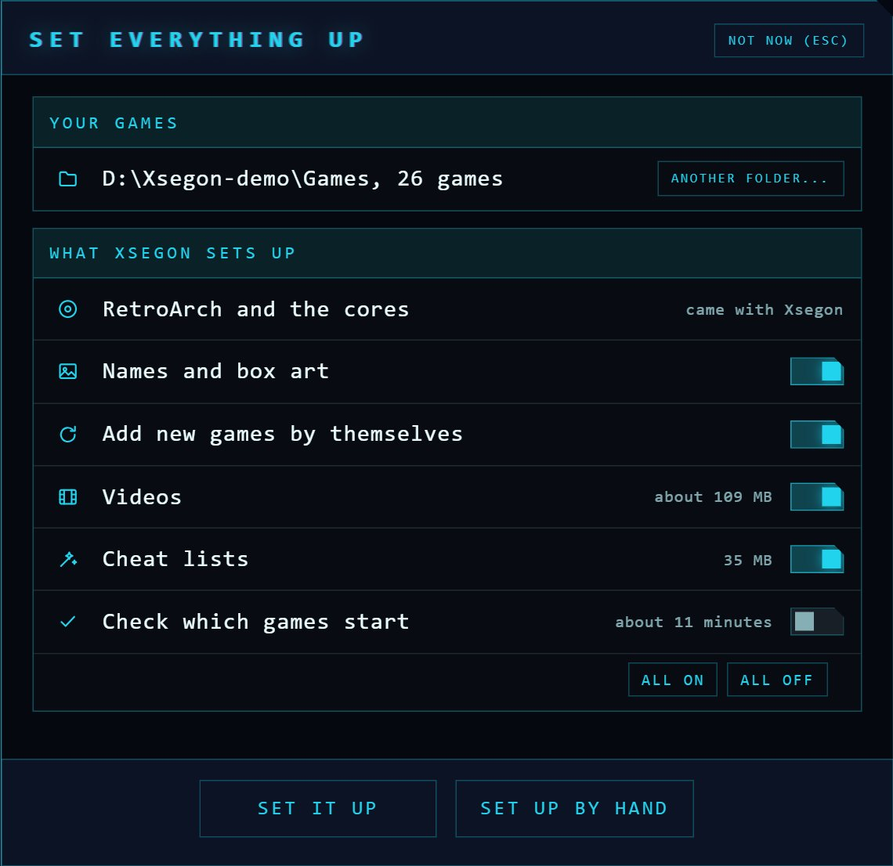

**Set up by hand** opens **Getting started** instead: every step, one at a
time, with a button for each.


Then leave it to it. A small list in the corner shows what it is doing:
setting up RetroArch (the program that plays the games, which comes with
Xsegon), fetching the cores your consoles need, finding your games, and
fetching their names and box art. When the list says **Ready to play**, you
are. You can look around while it works.


Not sure where to put your games? Xsegon made a **Games** folder beside
itself, with a folder inside for each console. Press **Set it up** anyway:
Xsegon sets up the rest, then says where that folder is, with a button that
opens it. Drop your games in, come back to Xsegon, and they come in by
themselves.

## 4. Getting around

You start on your consoles. Turn to one and open it to see its games.

| To | Keyboard | Controller |
|---|---|---|
| Move | The arrow keys | The cross or the left stick |
| Open a console, or play a game | Enter | A |
| Go back | Esc | B |
| See a game's own page | Space | X |
| A game's menu | Right-click | Y |
| Find a game | / and a few letters | |
| Change how the games are shown | G | |
| Stop playing a game | Esc, in the game | |

You do not have to remember any of it: the bar along the bottom of the
screen always shows what the keys do right now, and with a controller it
shows that controller's own buttons.

The menus (Games, Emulators, Help) and Get Media open from the Xsegon
logo at the top left, on every screen, with Settings, the controller, Connect
a phone and the themes beneath them.


## 5. If something goes wrong

- **Stuck somewhere?** Press Esc a few times. It always backs out one step.
- **Still stuck?** Close Xsegon and start it again. Nothing is lost: it keeps
  everything as you go.
- **Games with names but no pictures?** Choose List or Grid, then Pictures &
  Videos > Get Pictures.
- **A game will not start?** A red line at the bottom says why. A few consoles
  (the PlayStation is one) need a BIOS file of your own: Emulators > BIOS
  check says which one and where it goes. Xsegon never downloads one.
- **A controller that works in Xsegon and not in a game?** The Controller
  check has Wrong in a game?, which says what to do.
- **Xsegon will not open at all?** A black window comes up and says why.

## Updating to a newer version

Xsegon says in Messages when a new version is out, once for each version.
Press **Update now...**: it says what happens and asks whether the next new
versions should download by themselves. Then it downloads the new version
(about 7 MB), checks it and tries it once, takes a backup of your data,
closes, puts the new version in place and opens again. A damaged download is
never put in place, and if the new version will not start on your PC the one
before comes back by itself. Settings > Window > New versions has **Go
back**, the same download choice, and switches the messages off.

To update by hand instead:

1. Settings > Library > Backup, to be safe.
2. Close Xsegon.
3. Download the new zip from the [latest release](https://github.com/TumultuousProductions/Xsegon/releases/latest)
   and unblock it as in step 2 above.
4. Extract it into the **same folder** as before, and choose **Replace the
   files** when Windows asks.

Your games, settings, play history and pictures live in the `Xsegon\data`
folder. The download has no `data` folder, so extracting over the old one
keeps them.

## Good to know

- Your game files are only ever read. Xsegon never changes or moves them.
- Make it look your own: Settings > Feel > Your own look > Open my folder
  gives you a stylesheet that Xsegon reads after its own. Updates never
  touch that folder.
- Everything Xsegon makes lives inside the folder you unzipped. To remove it,
  close Xsegon and delete that folder. Nothing is installed anywhere else.
- After the first setup it works without the internet. Only fetching
  pictures, videos and cheat lists needs it, and a look once a day for a
  newer Xsegon, which Settings > Window > New versions switches off. A new
  version (about 7 MB) is downloaded only when you press Update now, or by
  itself if you chose that.
- It only ever answers this PC: nothing else on your network can reach it,
  unless you switch on Connect a phone.

## Help

Settings > Debug > Report a problem... > Make a report > Save a copy puts what
happened into one small file in your Downloads folder. Send it, with a line
or two about what you were doing, to help@tumultuousproductions.site. It holds
Xsegon's own record of what happened, your settings and the names of your
games; never your games, pictures or videos.

## A very large library

Xsegon lets each of its requests use up to 1.5 GB of memory, where PHP by
itself allows 128 MB. A request takes only what it needs: about 30 MB for
750 games, about 300 MB for 40,000. The 1.5 GB is room for a library of
about 200,000 games.

A list longer than 2,000 games opens on its first 2,000 at once, and the
rest is added as you go, a piece at a time between your presses, with a bar
in the corner until every game is in. Settings > View > Games shown at once
is how many open at once. In Random order a list shows that many and no
more, and says so. With tens of thousands of games in a single list, moving
through it is slower than in a small one.

For more than that, raise `memory_limit` in the `php.ini` of the PHP that
runs Xsegon (in a download, `Xsegon\runtime\php\php.ini`) to a larger
figure such as `4G`, and start Xsegon again. A setting higher than
Xsegon's own is left as it is.

## Running from the source code

This part is for people who work on Xsegon. To play, use the
[release download](https://github.com/TumultuousProductions/Xsegon/releases/latest).
To change your own copy, [Change Xsegon yourself](CONTRIBUTING.md) is enough.

- **PHP 8** (tested on 8.5), with the `curl`, `mbstring` and `openssl`
  extensions switched on in `php.ini`, either on your PATH or unzipped beside
  the Xsegon folder. The games database is read by the same PHP, with its
  `sqlite3`, `bz2` and `intl` extensions, which Xsegon loads itself.
- **Node.js 22.5 or newer**, only for the tests and the tools in `tools\`.
  Xsegon itself does not use it.

Then run `.\start.ps1` in PowerShell. Some parts are not in the repository
and are fetched by a tool, each pinned to one checked version:

| Part | Fetched by |
|---|---|
| The games database (about 70 MB) | Xsegon itself, the first time it starts ([gamesdb/README.md](gamesdb/README.md)) |
| 7-Zip's `7zr.exe` | `node tools\get-7zr.js` |
| `ffmpeg.exe` | `node tools\get-ffmpeg.js` |
| RetroArch's archive | `node tools\get-retroarch.js` |

- `node tests\run.js` runs the tests (`node tests\lanes.js` runs them in two
  lanes, `node tests\lanes.js quick` in about three minutes).
- `node tools\make-test-copy.js <folder> --release` makes the download.
- `node tools\privacy-scan.js` checks what the repository would hold for
  anything that belongs to the PC it was written on; `tools\hooks\pre-push`
  runs it before every push (`git config core.hooksPath tools/hooks`).

## License

MIT (see [LICENSE](LICENSE)). The games database Xsegon downloads is
LaunchBox's, not covered by it; see Credits. Nor are the programs the download carries
unchanged, each under its own licence with that licence beside it: 7-Zip's
`7zr.exe` (GNU LGPL), `ffmpeg.exe` (GNU GPL v3) and RetroArch (GNU GPL v3),
nor the console icons in [img/consoles](img/consoles/ABOUT.txt), which are
RetroArch's (CC-BY 4.0), nor the console name logos in
[img/console-logos](img/console-logos/ABOUT.txt), which are their owners'
trademarks (see Trademarks). [THIRD-PARTY.txt](THIRD-PARTY.txt) lists every
part that is not Xsegon's own. The sounds in
[sounds/Xsegon 2](sounds/Xsegon%202/ABOUT.txt), and Hover.wav in
[sounds/Xsegon](sounds/Xsegon/ABOUT.txt), are Xsegon's own.

## Trademarks

The names and logos of the consoles Xsegon lists are trademarks of their
owners: Nintendo, Sony Interactive Entertainment, Microsoft, Sega, Atari,
SNK and the others whose consoles it names. MAME is a registered trademark
of Gregory Ember; its logo stands on Arcade and MAME. Xsegon shows them for
one purpose, to say which console a game is for. It is not made, sponsored,
approved or endorsed by any of those companies or by the MAME team, and has
no connection with them. Xsegon comes with no games, no BIOS files and no keys. An owner who
wants a logo taken out has only to ask: help@tumultuousproductions.site.

## Credits

- Game details, descriptions and pictures: the
  [LaunchBox Games Database](https://gamesdb.launchbox-app.com), by
  [LaunchBox](https://www.launchbox-app.com) and the people who add to it. A
  copy comes with the download and keeps itself up to date
  ([gamesdb/](gamesdb/README.md)).
- Names, details and pictures when that is not used, or its pictures cannot
  be fetched: [libretro](https://github.com/libretro) (libretro-thumbnails and
  libretro-database), the lists RetroArch uses.
- Games are started by [RetroArch](https://www.retroarch.com), by libretro,
  carried unchanged in the download under the GNU GPL v3, with its licence
  and where its source is beside it (`runtime\RetroArch`).
- The console icons: RetroArch's menu icons (the XMB "retrosystem" theme, and
  "daite" for the PSP) by the libretro team and contributors, from
  [retroarch-assets](https://github.com/libretro/retroarch-assets), unchanged,
  under [CC-BY 4.0](https://creativecommons.org/licenses/by/4.0/)
  ([img/consoles/ABOUT.txt](img/consoles/ABOUT.txt); `node
  tools\get-console-icons.js` fetches them).
- The console name logos on the wheel, and Steam's icon: 53 files from
  [Wikimedia Commons](https://commons.wikimedia.org/wiki/Category:Video_game_console_logos),
  each marked Public domain or CC0 on its page there and each still its
  owner's trademark. Dark ones are lightened for a dark screen; nothing is
  redrawn. [img/console-logos/ABOUT.txt](img/console-logos/ABOUT.txt) lists
  every one with its owner, its page and who Commons names as its author
  (`php tools\get-console-logos.php` fetches them and checks each mark).
- Unpacking RetroArch: `7zr.exe` from [7-Zip](https://www.7-zip.org) by Igor
  Pavlov, shipped unchanged in the download under the GNU LGPL (`node
  tools\get-7zr.js` fetches it into a checkout).
- The controller outlines in Settings > Xsegon Controls: the Xbox 360 gamepad
  by Grumbel of the Open Clip Art Library
  ([Wikimedia Commons](https://commons.wikimedia.org/wiki/File:Xbox360_gamepad.svg),
  CC0) and the DualShock 4 layout by Tokyoship
  ([Wikimedia Commons](https://commons.wikimedia.org/wiki/File:Dualshock_4_Layout.svg),
  [CC BY 3.0](https://creativecommons.org/licenses/by/3.0/)). Only the outline
  of each is used, scaled, with no logo or lettering (`js\padpic.js`). The
  shapes of the controllers are their makers' own.
- The names of arcade games: MAME's own list of its machines, from
  [MAME](https://www.mamedev.org) by the MAME team (GNU GPL version 2 or
  later, most of its source BSD 3-Clause). Xsegon keeps four facts a
  machine, its short name, title, kind and parent
  ([includes/arcade/ABOUT.txt](includes/arcade/ABOUT.txt);
  `php tools\get-arcade-names.php` makes it). Xsegon comes with no MAME and
  no arcade games.
- Videos of arcade games, where a person asks for them (Get Media >
  Videos from online archives, which asks here first): scraping using
  [Arcade Database](https://adb.arcadeitalia.net) by motoschifo. The videos
  are its Progetto VideoSnaps, played and recorded by motoschifo, AntoPISA,
  adolfo69 and others, each named inside its file. Xsegon carries none of
  them: it asks about one game at a time and fetches the video for the game
  on the person's own PC.
- Videos for the other games with none, where a person asks (Pictures &
  Videos > Videos from online archives): sets of game videos on the
  [Internet Archive](https://archive.org), and the recordings of
  [World of Longplays](https://longplays.org), whole games played by its
  members and put on the Archive, each recording naming its player. Where a
  set leaves a gap, Xsegon keeps the first 30 seconds of the game's recording
  as its video and writes the player's name in its log. Xsegon carries none
  of the videos ([includes/archivevid/ABOUT.txt](includes/archivevid/ABOUT.txt)).
- Manuals for the games with none, where a person asks (Get Media >
  Manuals from online archives): sets of game manuals on the
  [Internet Archive](https://archive.org), a console each, scanned and put
  up by the people who kept them. Xsegon carries none of the manuals
  ([includes/archivedoc/ABOUT.txt](includes/archivedoc/ABOUT.txt)); the rest
  can come from [ScreenScraper](https://www.screenscraper.fr) with the
  person's own account, as its videos do.
- Texture packs listed in a game's details (the Texture packs tab of PS2,
  GameCube, Wii and N64 games): the
  [Texture Packs Archive](https://docs.google.com/spreadsheets/d/1sif8FeRGJRbytK8wFRXgF6Hke9V6GUFs),
  the community's list kept by Sad Origami. Every pack is its maker's own,
  named on its row with its maker's tip page. Xsegon carries the list and
  none of the packs: a press opens a pack's own page, or, for the packs
  of [Emulation King](https://emulationking.com) and
  [evilgames.eu](https://evilgames.eu), fetches the pack from there on the
  person's own PC ([includes/texpacks/ABOUT.txt](includes/texpacks/ABOUT.txt);
  `node tools\build-texpacks.js` makes the list). A few packs the Archive
  does not list are added by hand (`tools\texpacks-more.json`), marked so on
  their rows.
- Cutting those recordings: `ffmpeg.exe` from the
  [FFmpeg project](https://ffmpeg.org), the release essentials build for
  Windows by [Gyan Doshi](https://www.gyan.dev/ffmpeg/builds/), shipped
  unchanged in the download under the GNU GPL v3 with its licence beside it
  (`node tools\get-ffmpeg.js` fetches it into a checkout).
- The list of controllers read for a controller the browser does not know:
  [SDL_GameControllerDB](https://github.com/mdqinc/SDL_GameControllerDB), under
  the zlib licence, unchanged, with its licence beside it in
  `includes\padlist\` (`node tools\get-controller-list.js` fetches it).
- The colours of the Dracula themes: the [Dracula](https://draculatheme.com)
  colour palette, Copyright (c) 2023 Dracula Theme, under the
  [MIT licence](https://github.com/dracula/dracula-theme/blob/main/LICENSE).
  The quilt behind them and the bat are Xsegon's own drawing.
